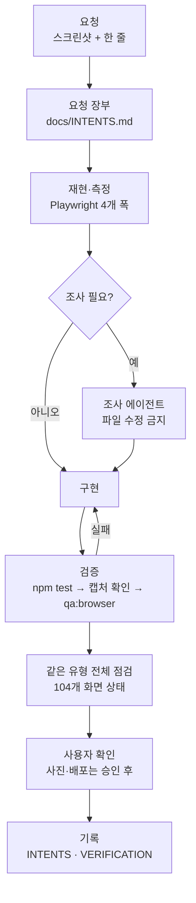
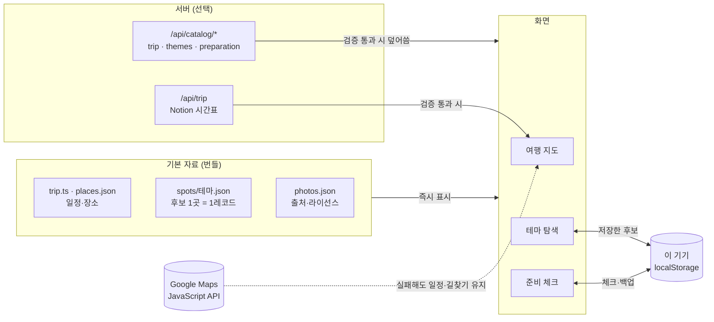
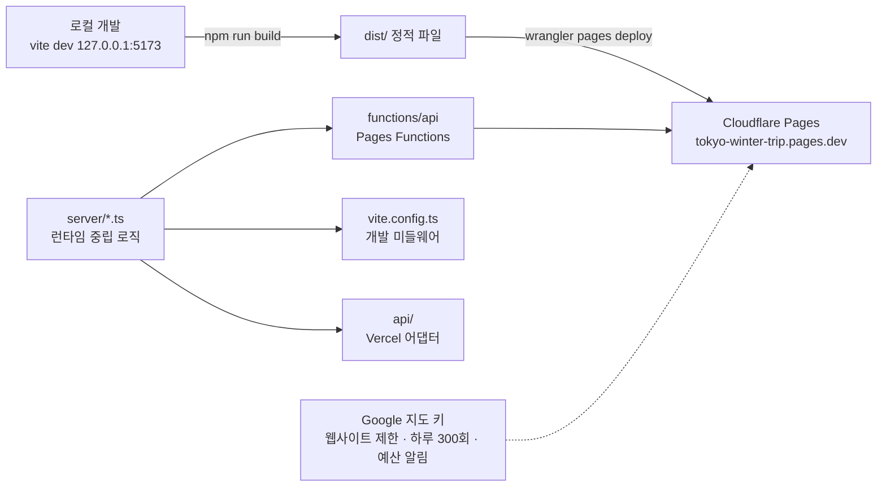

# tokyo. 여행 노트 — 도쿄 2026 겨울 여행 지도

2026년 12월 11~15일(4박 5일) 3인 도쿄 여행을 위한 웹앱입니다. 날짜별 일정과 지도, 13개 테마의 가볼 만한 곳, 출발 전 준비 체크를 한곳에 모았습니다.

**배포:** https://tokyo-winter-trip.pages.dev · **저장소:** https://github.com/researcherhojin/tokyo-winter-trip

이 저장소는 앱 코드와 함께, Claude Code와 대화하며 앱을 만든 과정(요청·프롬프트·검증 흐름)을 문서로 남긴 기록이기도 합니다. → [만든 과정](docs/PROMPTS.md)



## 화면

| 화면 | 내용 |
| --- | --- |
| **여행 지도** | 5일 일정 · 방문 장소 14곳 + 숙소. 번호 마커와 일정이 연결되고, 구간별 대중교통·도보 길찾기, 방문 가이드(진행 순서·확인할 것·다음 이동), 방문 상태 기록 |
| **테마 탐색** | 13개 테마 · 88개 후보(12월 시즌 / 도시 산책 / 취향 탐방 / 먹거리 / 쇼핑·근교). 카드는 사진·핵심 운영 정보만, 상세·출처는 정보 창에. 후보 저장 |
| **준비 체크** | 17개 항목을 3단계 탭으로. 우선 확인 3가지, 실행 안내와 공식 링크, 기기 저장·백업 |

## 원칙

- **공식 발표만** 씁니다. 운영사·구청·관광청이 낸 정보만 카드와 일정에 올리고, 보도·리스팅·지난해 값·추정은 쓰지 않습니다.
- **사진은 자유 라이선스만**(CC0·PD·CC BY·CC BY-SA), **자르지 않습니다.** 정확한 사진이 없으면 「비슷한/판매처/제조사 참고 사진」 배지와 차이 설명을 붙입니다. 출처·저자·라이선스는 [사진 아카이브](docs/PHOTO_ARCHIVE.md)와 `public/photos/LICENSE.md`에 있습니다.
- **계획·예약·결제를 구분합니다.** 일정 시간은 계획값이고, 체크·저장은 이 기기에만 남습니다.
- **지도 없이도 동작합니다.** 키가 없거나 지도가 실패해도 일정·길찾기는 그대로 씁니다.

## 실행

Node.js 22.12 이상.

```bash
npm ci
npm run dev            # http://127.0.0.1:5173
npm run check          # 테스트 · 철자 · 키 패턴 검사
npm run qa:browser     # 실행 중인 dev 서버를 실제 Chrome으로 점검(Playwright CLI 필요)
```

지도를 보려면 `.env.example`을 `.env`로 복사하고 `VITE_GOOGLE_MAPS_API_KEY`를 넣습니다. 키는 Google Cloud에서 **웹사이트 제한**과 **Maps JavaScript API 제한**을 건 브라우저용 키만 쓰세요. 자세한 설치·키·기능 설명은 [docs/SETUP.md](docs/SETUP.md).

## 구조

```
src/
  components/   화면(여행 지도·테마 카드·준비 체크·사진 창)
  data/         일정·장소·사진 manifest, spots/<테마>.json (후보 1곳 = 1레코드)
  lib/          지도 범위·사진 순서·URL 상태 등 로직
  styles/       base → trip → theme → preparation
server/         Notion 읽기·카탈로그 응답(런타임 중립)
functions/api/  Cloudflare Pages Functions   api/  Vercel
scripts/        Playwright 시나리오·전체 화면 점검·사진 아카이브
tests/          node:test (jsdom 통합·카탈로그 계약)
```

React 19 · TypeScript · Vite · Google Maps JavaScript API · Cloudflare Pages. 모듈별 책임은 [ARCHITECTURE](docs/ARCHITECTURE.md).

### 데이터 흐름



### 배포 구조



## 문서

| 문서 | 내용 |
| --- | --- |
| [PROMPTS](docs/PROMPTS.md) | 사용한 프롬프트와 작업 흐름 |
| [INTENTS](docs/INTENTS.md) | 요청 장부: 요청마다 완료 기준·검증 근거 |
| [PROJECT_STATUS](docs/PROJECT_STATUS.md) | 현재 상태와 남은 작업 |
| [ARCHITECTURE](docs/ARCHITECTURE.md) | 모듈 책임표 |
| [VERIFICATION](docs/VERIFICATION.md) | 검증 기록 |
| [DEV_FLOW](docs/DEV_FLOW.md) | 요청 처리 순서·조사 에이전트 규칙 |
| [DEPLOYMENT](docs/DEPLOYMENT.md) | 배포 |

## 라이선스

코드는 개인 프로젝트로 공개합니다. 사진은 각 원저작자의 라이선스를 따르며 목록은 `public/photos/LICENSE.md`에 있습니다. 여행 정보는 각 공식 출처의 내용이며 방문 전 원문을 다시 확인하세요.
