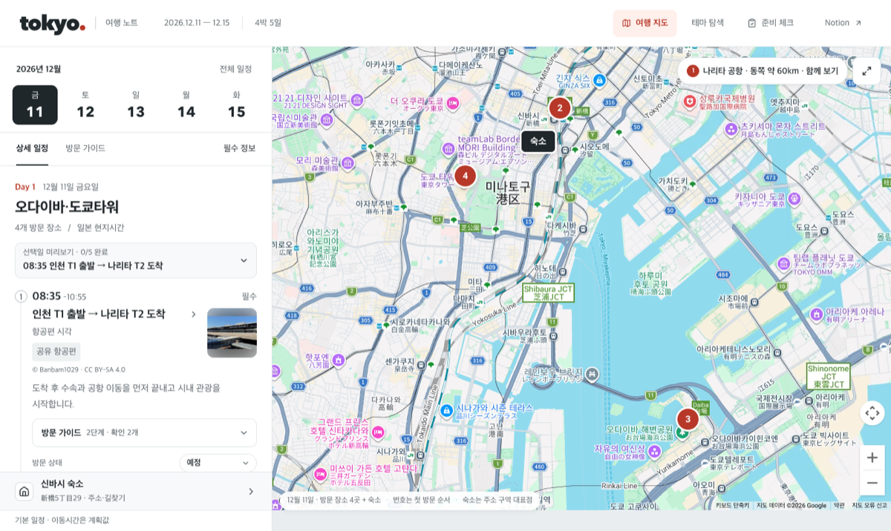
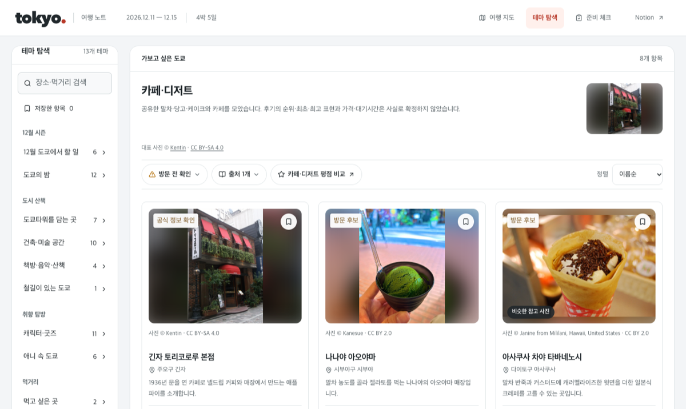
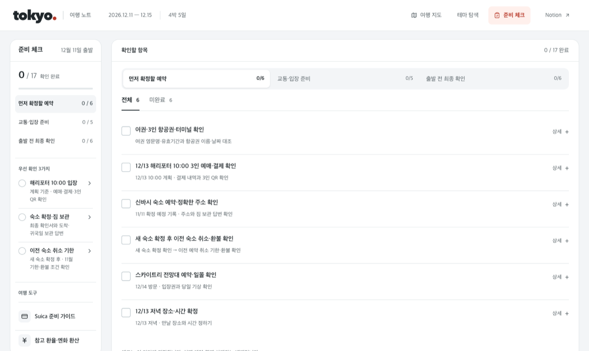
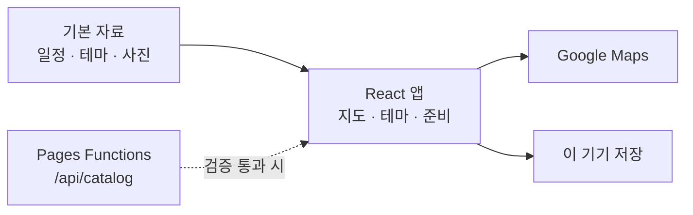
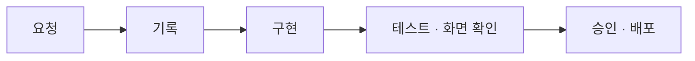

# Tokyo Winter Trip 2026

도쿄 4박 5일(2026.12.11–12.15) 여행을 위한 일정·지도·테마 탐색·준비 체크 웹앱입니다.

**[사이트 열기](https://tokyo-winter-trip.pages.dev)** · [만든 과정](docs/PROMPTS.md) · [요청 기록](docs/INTENTS.md)



## 기능

| 화면 | 내용 |
| --- | --- |
| **여행 지도** | 날짜별 일정과 지도 마커, 구간별 길찾기, 방문 가이드 |
| **테마 탐색** | 13개 테마 · 88개 후보, 공식 운영 정보와 출처 |
| **준비 체크** | 3단계 17개 항목, 이 기기에 저장·백업 |

| 테마 탐색 | 준비 체크 |
| --- | --- |
|  |  |

## 원칙

- **운영 정보는 공식 발표만**: 시간·휴무·요금·행사는 운영사·관광청 발표만 싣고, 추정이나 지난해 값은 쓰지 않습니다.
- **자유 라이선스 사진만**: CC0·퍼블릭 도메인·CC BY·CC BY-SA 사진을 자르지 않고 씁니다. 대체 사진에는 「비슷한 참고 사진」 표시를 붙입니다.
- **지도 없이도 동작**: 지도가 실패해도 일정과 길찾기는 그대로 쓸 수 있습니다.

## 시작하기

```bash
npm ci
npm run dev      # http://127.0.0.1:5173
npm run check    # 테스트 · 철자 · 키 검사
```

지도를 보려면 `.env`에 `VITE_GOOGLE_MAPS_API_KEY`를 넣습니다. 웹사이트 제한을 건 키만 쓰세요. 자세한 설명은 [SETUP](docs/SETUP.md)에 있습니다.

## 구조



React · TypeScript · Vite · Google Maps JavaScript API · Cloudflare Pages. 모듈 설명은 [ARCHITECTURE](docs/ARCHITECTURE.md)에 있습니다.

## 만든 방식

Claude Code와 대화하며 만들었습니다. 요청마다 기록 → 구현 → 테스트·실제 브라우저 확인 → 승인·배포를 반복했습니다.



[사용한 프롬프트와 흐름](docs/PROMPTS.md) · [검증 기록](docs/VERIFICATION.md) · [현재 상태](docs/PROJECT_STATUS.md)

## 라이선스

- 코드: [MIT](LICENSE)
- 사진: 각 저작자의 라이선스 ([목록](public/photos/LICENSE.md))
